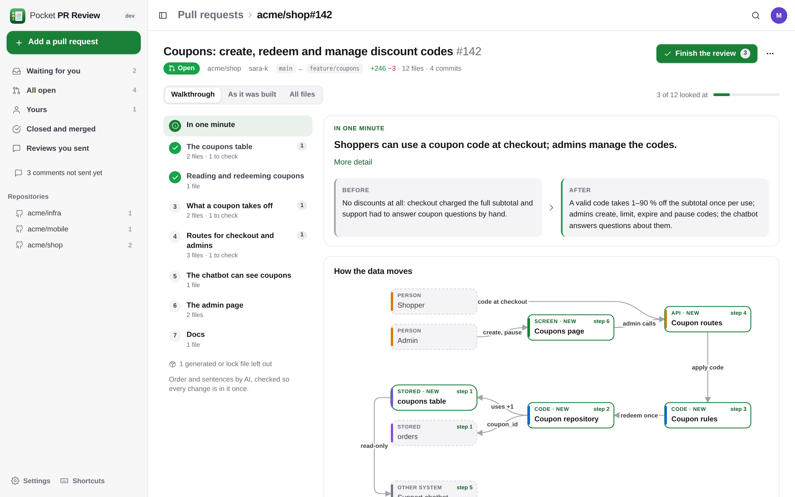
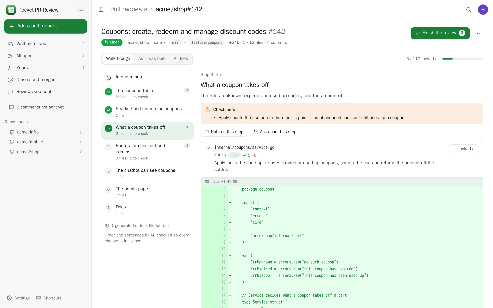
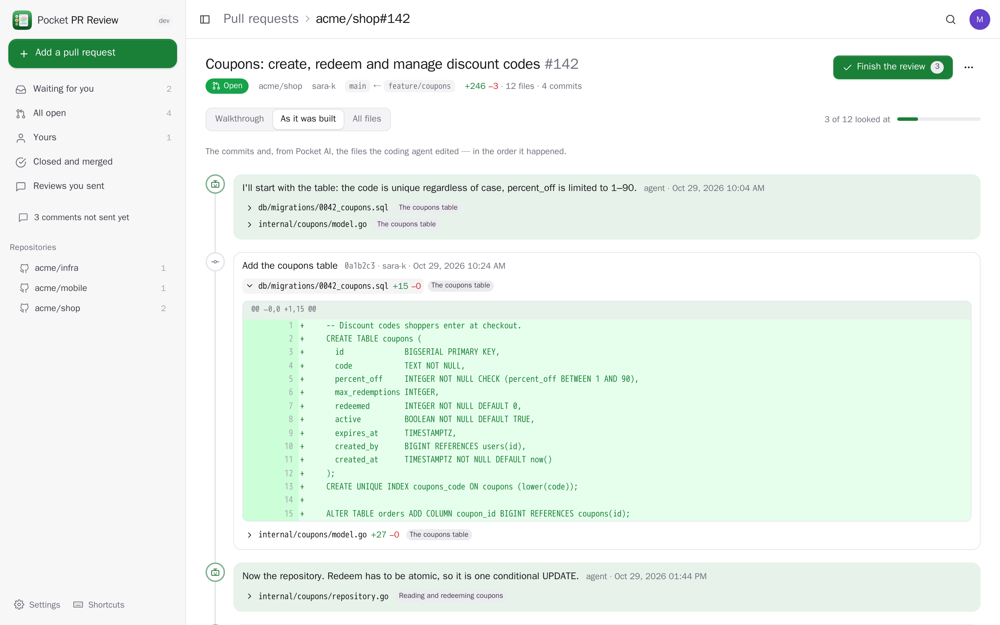
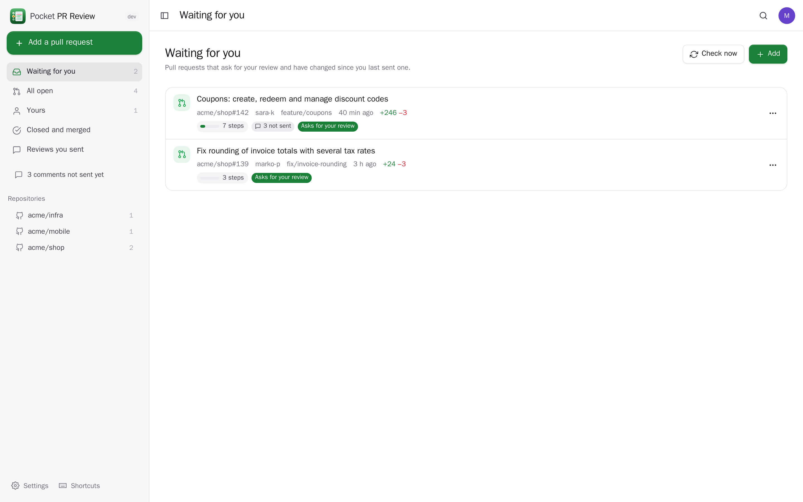
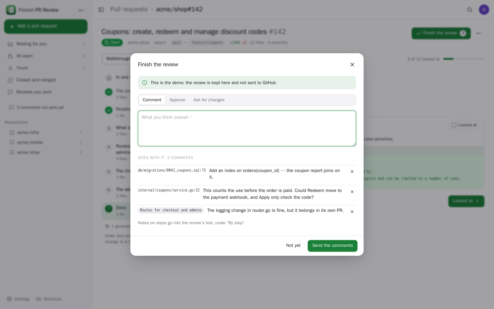
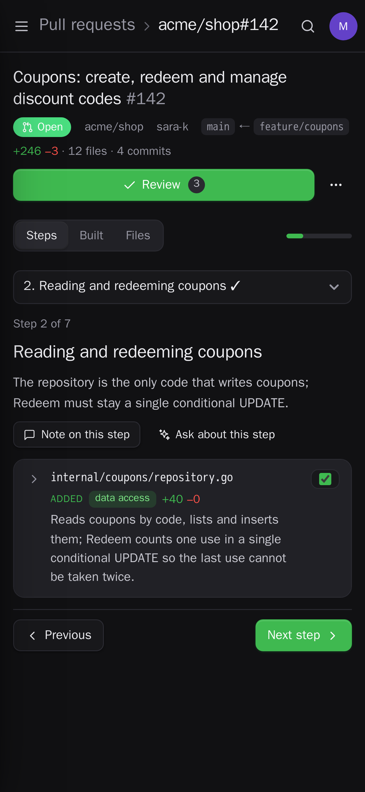
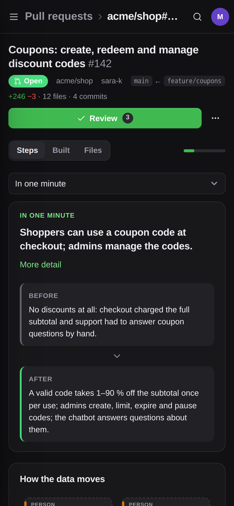
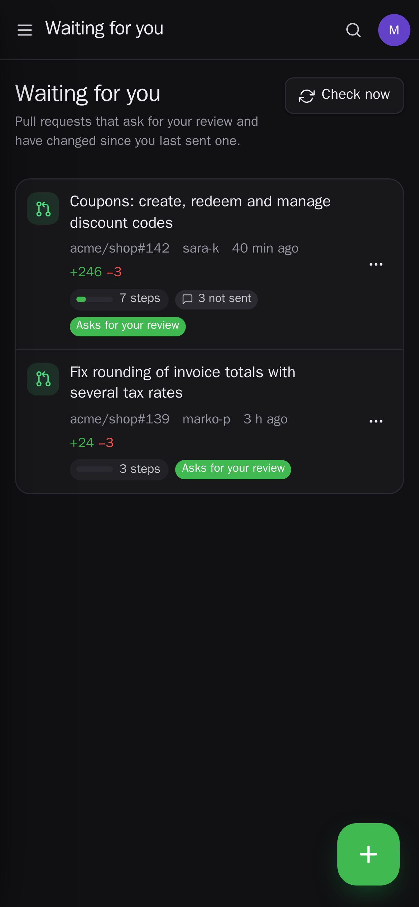

<p align="center"></p>
<h1 align="center">Pocket PR Review</h1>
<p align="center">Review pull requests as a story, not an alphabetical list of files. A walkthrough puts the changes in the order to read them — the migration first, then the repository that reads and writes the new table, the service on top, the routes that expose it, the chatbot's configuration that uses it, the admin page — with one plain sentence per file, what to check in each step, and the pull request in one minute. See how it was built, commit by commit or edit by edit when a coding agent wrote it; mark what you looked at and see what changed since; send your review to GitHub, or hand your comments to a coding agent.<br>One Go binary, one SQLite file, one volume. Part of the Pocket apps; works on its own too.</p>
<p align="center">
  <a href="https://github.com/abjelosevic88/pocket-homelab-pr-review/actions"></a>
  <a href="https://github.com/abjelosevic88/pocket-homelab-pr-review/pkgs/container/pocket-homelab-pr-review"></a>
  <a href="LICENSE"></a>
</p>

---

<p align="center"></p>

<table>
  <tr>
    <td width="50%"></td>
    <td width="50%"></td>
  </tr>
  <tr>
    <td align="center"><sub>A step: why it is there and what to check, each file with one sentence, its diff with your comments and the GitHub conversation.</sub></td>
    <td align="center"><sub>As it was built: the commits — and, from Pocket AI, what the coding agent said before each edit — in order.</sub></td>
  </tr>
  <tr>
    <td width="50%"></td>
    <td width="50%"></td>
  </tr>
  <tr>
    <td align="center"><sub>What waits for you: every pull request that asks for your review, its walkthrough already made.</sub></td>
    <td align="center"><sub>Finish the review: your line comments and notes per step go to GitHub as one review.</sub></td>
  </tr>
</table>

<p align="center">
  &nbsp;&nbsp;
  &nbsp;&nbsp;
  
</p>

## Why

A pull request page lists the changed files by name. That is the order of the alphabet, not of the change: the admin page comes before the migration it needs, the routes before the service they call. Agents now write pull requests of fifty files, and the reviewer has to rebuild the story in their head. Pocket PR Review rebuilds it for them.

## What it does

- **Walkthroughs**: every change in reading order, grouped into steps — the data, what reads and writes it, the logic, the API, the configuration and prompts, the screens, then tests and docs. Each step says why it is there and what to check; each file gets one sentence. A file whose changes belong to different steps (a new route and an unrelated logging fix) is split between them.
- **Nothing hidden**: the walkthrough is checked so that every changed line is in it exactly once; anything the AI left out goes into “Everything else”. Lock files and generated code are set aside, not dropped.
- **The order is sound**: layers by path (migrations, repositories, services, routes, YAML, pages…) and the imports the change adds — a file never comes before what it uses — then the AI groups and names the steps. Without an AI you still get the layered order.
- **Your codebase's rules**: put a `.pocket/review.yml` in a repository (or hints in Settings) and the order follows it:
  ```yaml
  hints: The chatbot's tools live in apps/chatbot/*.yaml and come after the routes.
  order:
    - name: Migrations
      paths: ["packages/db/migrations/**"]
    - name: Repositories
      paths: ["**/repositories/**"]
  noise: ["**/*.snap"]
  ```
- **As it was built**: the commits in order with what each one changed; when a coding agent in Pocket AI made the pull request, also every file it edited and what it said just before.
- **The pull request in one minute**: one sentence on what it does, before and after, a diagram of how the data moves through what it adds (new pieces and existing ones, what moves along each arrow, each box opening its step), the steps with how much each changes, the risks worth a careful look (high, medium, low, with their files), the codebase's words a newcomer needs, and questions for the author. Written for someone who has never seen the pull request. Ask the AI about a step.
- **What you looked at**: mark a file or a whole step; a later commit that changes a part unmarks just that part (“changed since you looked”). New commits make a new walkthrough by themselves.
- **Review where you read**: comment on a line or a range, note on a step, read and answer the GitHub conversation in place, then approve, ask for changes or comment — sent to GitHub as one review. Or post the walkthrough on the pull request for the whole team.
- **Hand it to a coding agent**: your comments go to Claude Code or Codex through Pocket AI, in the repository's folder on the pull request's branch; you read the prompt there and press send.
- **Your list, by itself**: pull requests that ask for your review, yours, and the ones you reviewed come in from GitHub every few minutes; a push when someone asks for your review.
- **Everyone their own**: each person uses their own GitHub token; their pull requests, comments and settings are theirs; admins see no one else's.

## Run it

```sh
docker run -d --name pocket-pr-review -p 8080:8080 -v ./data:/data \
  -e BASE_URL=https://pr.example.com -e SECURE_COOKIES=true \
  ghcr.io/abjelosevic88/pocket-homelab-pr-review:latest
```

or `docker compose up -d` with [docker-compose.yml](docker-compose.yml). Open it, create the first account and add your GitHub token under Settings → GitHub (a fine-grained token with *Pull requests: read and write* and *Contents: read*). For walkthroughs with sentences, connect Pocket AI through Pocket Core or add an OpenAI-compatible key under Settings → AI. All options: [docs/configuration.md](docs/configuration.md). API: [docs/api.md](docs/api.md). Backups: [docs/backup.md](docs/backup.md).

Add a pull request from anywhere with a bookmarklet: `https://pr.example.com/?add=` + its address.

## With Pocket Core

Set `CORE_URL` and `CORE_REGISTRATION_KEY` and PR Review joins the box: people sign in with Pocket Core, walkthroughs are written by Pocket AI with nothing to paste, and through app links each person's Pocket AI takes review comments (`threads:write`) and tells which files its agent edited in which order (`threads:read`). Other Pocket apps can read your reviews (`prs:read`: the list, walkthroughs, each day's reviews — Pocket Day's journal, dashboards, Pocket Projects' issues) or add a pull request and make its walkthrough (`prs:write`: never sending a review). Events on the bus: `pr-review.review_requested`, `pr-review.walkthrough_ready`, `pr-review.review_sent`. Without Core the Pocket AI connection can be made directly with a URL and a token; the Core-only choices stay visible, greyed out.

## Develop

```sh
make dev     # API on :8080 with demo data + Vite on :5173
make test    # go vet, go test, tsc
make         # web + binary
```

MIT licensed. Not affiliated with GitHub.
